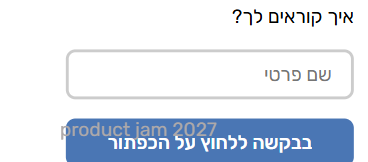
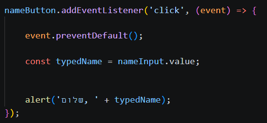
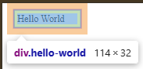
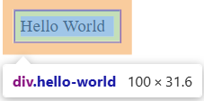
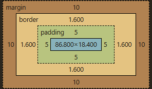
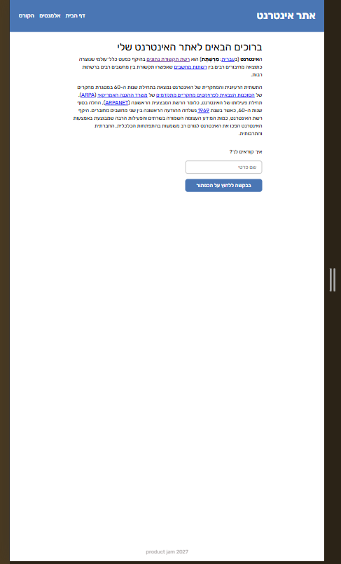

# Answers

Answer the questions below in this file, under each question. Put screenshots in
a `screenshots/` folder and link them from your answers.

## 1. Challenges and dilemmas

List at list 2 challenges or dilemmas that you faced while building the design in Part 1,
and how you decided to solve them?

**Answer:**
1. **Footer Overlapping on Mobile:** 
One challenge I faced was that the fixed footer overlapped the form's submit button on smaller mobile screens. To solve this, I added a media query that changes the footer's position from `fixed` to `static` on mobile devices. This restored the footer to the natural document flow and prevented it from hiding the button.



2. **Form Submission Refresh vs. Semantic HTML:** 
A dilemma I had was handling the "Say hello" button. Because it was nested inside a `<form>` tag, clicking it refreshed the page by default. I considered replacing the form with a simple `<div>` to avoid this, but I decided to keep the `<form>` tag to maintain semantic HTML, accessibility, and "Enter" key keyboard support. I solved this by using JavaScript's `event.preventDefault()` inside the event listener to stop the default submission behavior while successfully triggering the alert.



## 2. Box model

Build the `.hello-world` example from the lesson 1 "CSS Box Model" slides, exactly as it appears
there, on a new page of your website. This page is only for answering questions
2 and 4, so it can be a temporary file, and you don't need to submit it.

Inspect the element with your browser's devtools.
Enable and disable `box-sizing: border-box;` and inspect the size of the element.
What is the total width, and why? Explain in detail.

**Answer:**
I'll use the shortcut BSBB for box-sizing: border-box
The total size without BSBB is 114px and with BSBB is 100px
thats because without BSBB the padding (5px each side) and the border(2px each side)
are added to the width to give a total of 100 + 2*5 + 2*2 = 114.
however, if we use BSBB then the padding and border are also included in the 100px width








## 3. The viewport

Open the website on a mobile browser, or in the mobile view of Chrome's
devtools, then delete this line from the `<head>` of `index.html`:

```html
<meta name="viewport" content="width=device-width, initial-scale=1.0" />
```

What happens to your page? What does
this line tell the browser, and why does removing it affect your mobile design?

**Answer:**
It does not switch to mobile state, but rather looks like a scaled-down version of the desktop state. 

This line tells the mobile browser to set the width of the page to the actual width of the device screen (width=device-width) and sets the initial zoom level to 100% (initial-scale=1.0). 

Essentially, this line acts as a declaration to the browser that the website has a mobile-optimized version. Removing it affects the mobile design because without this declaration, the browser assumes the page is not optimized for mobile. It uses a default wide desktop viewport (usually around 980px) and just shrinks it to fit the screen. Because the browser now thinks its width is 980px, the CSS @media (max-width: 768px) queries were never triggered, and all the mobile styling was ignored.

